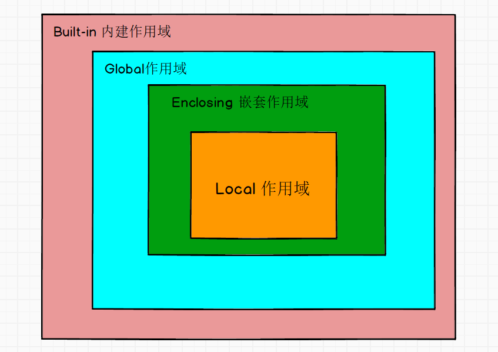
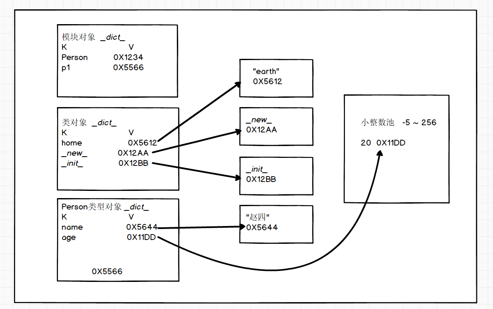

## day06 作用范围 文件读写  面向对象

### 1. 作用域



```python
"""
    L （Local） 局部作用域
    E （Enclosing）嵌套作用域 闭包函数外的函数中
    G （Global） 全局作用域
    B （Built-in） 内建作用域 Python提供好的
"""


# len = "Global : 全局作用域的变量len"

def func2():
    # len = "Enclosing : 嵌套作用域的变量len"
    def func1():
        # len = "Local : 局部作用域的变量len"
        print(len)
        # print(a) 如果四个范围都查找不到 就报错了
    func1()

func2()


```

### 2. global关键字

> global 关键字 显示声明使用全局作用域的变量 而非默认作用域

```python
"""
    global 关键字 显示声明使用全局作用域的变量 而非默认作用域
"""

list1 = [1,2,3]

def func1():
    list1[0] = 666 # 对于可变数据类型 可以直接修改数据

func1()
print(list1)

num = 100

def func2():
    global num # 显式说明 这里使用的是全局作用域的num 而非默认作用范围
    num = 200
    print(num)

func2()
print(num)
```


### 3. nonlocal关键字

> nonlocal 关键字 表示不使用默认作用范围 而使用嵌套函数范围的数据
>
> 使用nonlocal必须有嵌套函数 否则报错

```python
"""
    nonlocal 关键字 表示不使用默认作用范围 而使用嵌套函数范围的数据
    使用nonlocal必须有嵌套函数 否则报错
"""


def outer():
    a = 100
    def inner():
        nonlocal a # 表示使用外层嵌套函数中的a
        a = 200
        print(a)
    inner()
    print(a)


outer()


def func1():
    nonlocal a # 报错 因为func1函数不存在外层嵌套函数
    print(a)

func1()

```


### 4. 读取文件

> 读文件
> 当我们读取文件 默认的读取文件的编码格式 是按照本地平台(操作系统)默认的编码格式读取的
> 比如 中文操作系统 将以GBK编码格式读取

```python
"""
    读文件
    当我们读取文件 默认的读取文件的编码格式 是按照本地平台(操作系统)默认的编码格式读取的
    比如 中文操作系统 将以GBK编码格式读取
"""

# "C:\\Users\\WHD\\Desktop\\A.txt"
# reader = open("C:/Users/WHD/Desktop/A.txt","r",encoding="utf-8")
reader = open("C:/Users/WHD/Desktop/A.txt","r")

print(reader.read())

reader.close() # 关闭资源 关闭流


```

```python
"""
    使用相对路径  绝对路径   读取文件
"""

reader1 = open("C.txt","r",encoding="utf-8")

print(reader1.read())

reader1.close()

print("-----------------------------------------------------------------")

reader2 = open("./C.txt","r",encoding="utf-8")

print(reader2.read())

reader2.close()

print("-----------------------------------------------------------------")

reader3 = open("../A.txt","r",encoding="utf-8")

print(reader3.read())

reader3.close()

print("-----------------------------------------------------------------")

reader4 = open("C:\\Users\\WHD\\PycharmProjects\\AI0525\\day06\\A.txt","r",encoding="utf-8")

print(reader4.read())

reader4.close()

print("-----------------------------------------------------------------")

reader5 = open("../../B.txt","r",encoding="utf-8")

print(reader5.read())

reader5.close()


```

### 5. 写入文件

> 写入文件
> 写入文件的时候 如果文件不存在 会自动创建一个
> 写的时候指定模式 w 或者 a
> w write 会覆盖原文件中的内容
> a append 在原文件的基础上追加内容

```python
"""
    写入文件
    写入文件的时候 如果文件不存在 会自动创建一个
    写的时候指定模式 w 或者 a
    w write 会覆盖原文件中的内容
    a append 在原文件的基础上追加内容
"""
writer = open("D.txt","a",encoding="utf-8")

writer.write("123 456")

writer.flush() # 刷新缓存 将缓存中的数据刷新到硬盘中

writer.close() # 关闭资源


```

```python
"""
    写入文件
    写入文件的时候 如果文件不存在 会自动创建一个
    写的时候指定模式 w 或者 a
    w write 会覆盖原文件中的内容
    a append 在原文件的基础上追加内容
"""
writer = open("C:/Users/WHD/Desktop/B.txt","w",encoding="utf-8")

writer.write("hello world 世界你好 6666 D.txt")

writer.flush() # 刷新缓存 将缓存中的数据刷新到硬盘中

writer.close() # 关闭资源


```

### 6. 读写二进制文件

> 读写二进制文件
>
> 读取的模式 rb read binary
> 写入的模式 wb write binary

```python
"""
    读写二进制文件

    读取的模式 rb read binary
    写入的模式 wb write binary
"""

reader = open("C:\\Users\\WHD\\Desktop\\资料\\zs.jpg","rb")

read_data = reader.read()

writer = open("copy.png","wb")

writer.write(read_data)

reader.close()
writer.close()
```

### 7. 读写文件优化操作

> 读写文件的优化操作 我们之前的read() 无参 都是一次性将文件全部读取进来的
> 文件小没有问题 如果文件非常大 这样是非常不合适的 我们应该少量多次的循环读取 直到读取完毕
> ​    read(整数数值参数)
> ​    如果是文本文件 数值表示字符数
> ​    如果是二进制文件 数值表示字节

```python
"""
    读写文件的优化操作 我们之前的read() 无参 都是一次性将文件全部读取进来的
    文件小没有问题 如果文件非常大 这样是非常不合适的 我们应该少量多次的循环读取 直到读取完毕
        read(整数数值参数)
        如果是文本文件 数值表示字符数
        如果是二进制文件 数值表示字节
"""


def copy_file(src_file, dst_file):
    reader = open(src_file,"rb")
    writer = open(dst_file,"wb")

    while content := reader.read(1024):
        writer.write(content)#实现了边写边读
        
    reader.close()
    writer.close()


copy_file("C:\\Users\\WHD\\Desktop\\资料\\zs.jpg","new_zs.jpg")


```

```python
"""
    read()函数是有计数指针的 每一次读取都从上次一次读取的末尾继续
"""

reader = open("../A.txt","r",encoding="utf-8")

print(reader.read(1))
print(reader.read(1))

reader.close()

```

### 8. 读取一行、多行数据

> 读取一行  或者 多行文本内容
> readline()   读取一行
> readlines() 读取所有行

```python
"""
    读取一行  或者 多行文本内容
    readline()   读取一行
    readlines() 读取所有行
"""

reader = open("A.txt","r",encoding="utf-8")

# print(reader.readline(),end="")
# print(reader.readline(),end="")
# print(reader.readline(),end="")
# print(reader.readline(),end="")
# print(reader.readline(),end="")
# print(reader.readline(),end="")

print(reader.readlines(1))
```

### 9. walk函数

> walk()函数 用于文件遍历
> os.getcwd()表示当前位置

```python
"""
    walk()函数 用于文件遍历,返回的是一个列表
    os.getcwd()
"""

import os

for root , dir_name , file_name in os.walk("C://"):  # os.getcwd() 表示当前位置
    print("当前位置：",root)
    print("文件夹名称：",dir_name)
    print("文件名称：",file_name)


```

### 10. 面向对象相关概念

#### 10.1 万物皆对象

> 自然界中的任何事物 我们都可以理解为对象  通过属性和方法 将其描述具体 

#### 10.2 特征-属性(是什么？)

> 一类事物共同拥有的特征(信息) 在代码中使用属性描述  

#### 10.3 行为-方法(可以做什么？)

> 一类事物共同拥有的行为(动作) 在代码中使用方法描述 

#### 10.4 类和对象的关系

> 类是对象的抽象：类是一个抽象的概念 比如 ：人类 
>
> 对象是类的具体：对象现实世界中真实存在的实例  比如 ： 蔡徐坤 你的同桌 你的发小 等等呢个

### 11. 创建类和对象

> 面向对象
> 人类
> ​    特征-属性：姓名 年龄 性别 身高 体重 爱好 地址 学历……
> ​    行为-方法：吃饭 睡觉 做运动 学习
>
> PyCharm中 自动提示
> f field 字段 属性的含义
> m method 方法 函数的含义
> p property 属性(封装之后)

```python
"""
    面向对象
    人类
        特征-属性：姓名 年龄 性别 身高 体重 爱好 地址 学历……
        行为-方法：吃饭 睡觉 做运动 学习


        PyCharm中 自动提示
        f field 字段 属性的含义
        m method 方法 函数的含义
        p property 属性(封装之后)

"""


class Person:
    def __init__(self,name,age,gender,height,weight):
        self.name = name
        self.age = age
        self.gender = gender
        self.height = height
        self.weight = weight

    def eat(self):
        print(f"{self.name}在吃饭")

    def sleep(self):
        print(f"{self.name}在睡觉")

    def sport(self):
        print(f"{self.name}在做运动")


# 通过类创建对象 格式 类名()
p1 = Person("赵四",20,"男",175.5,70.5)


# 通过对象访问属性
# 格式 对象名.属性名
print(p1)
print(p1.name)
print(p1.age)
print(p1.gender)
print(p1.height)
print(p1.weight)


# 通过对象访问方法 行为
# 格式 通过对象名.方法名 访问

p1.sleep()
p1.eat()
p1.sport()

print("---------------------------------------------------------------------------------")


p2 = Person("大拿",22,"男",178,88)

print(p2)
print(p2.name)
print(p2.age)
print(p2.gender)
print(p2.height)
print(p2.weight)

p2.eat()
p2.sleep()
p2.sport()
```

### 12. 对象创建的过程

当我们创建一个对象

* 第一步：Python解释器底层会自动调用__ new __函数创建空对象 属性都未赋值的对象
* 第二步：将空对象传递给__ init __函数 赋值给self 
  * self表示当前对象 类似于Java中this
* 第三步：然后再继续调用__ init __ 函数 结合我们传入的实参 给各个属性赋值  
* 第四步：将堆中的地址值赋值给左侧的变量

> Python的设计思想是万物皆对象 任何事物都处理为对象 
>
> 模块属于对象
>
> 类也属于对象 
>
> 函数也属于对象



### 13. 通过self访问本类方法

> 通过self访问本类中的方法 行为  self.方法名()
>
> self 表示当前对象 即正在使用的对象

```python
"""
    面向对象
    人类
        特征-属性：姓名 年龄 性别 身高 体重 爱好 地址 学历……
        行为-方法：吃饭 睡觉 做运动 学习

    通过self访问本类中的方法 行为  self.方法名()

    self 表示当前对象 即正在使用的对象
"""


class Person:
    home = "earth"
    def __init__(self,name,age,gender):
        self.name = name
        self.age = age
        self.gender = gender

    def print_name(self):
        print(f"人的姓名是：{self.name}")

    def print_age(self):
        print(f"人的年龄是：{self.age}")

    def print_gender(self):
        print(f"人的性别是：{self.gender}")

    def print_info(self):
        self.print_name()
        self.print_age()
        self.print_gender()

p1 = Person("赵四",20,"男")
p1.print_info()


```

### 14. 类变量和实例变量

|          | 类变量                          | 实例变量               |
| -------- | ------------------------------- | ---------------------- |
| 位置     | 定义在类中                      | 定义在init函数中       |
| 访问方式 | 通过类名访问 也可以通过对象访问 | 必须通过对象访问       |
| 内存     | 只有一份                        | 每个对象维护各自的一份 |

```python
"""
    类变量：直接书写在类中 属于当前类 不属于任何对象  可以被此类的所有对象共享
      应该使用类名加点的方式访问
    但是也可以通过对象名加点的方式访问 但是不推荐

    实例变量：在__init__函数中定义的变量 属于实例级别的
    必须通过实例(对象)来访问

    实例：instance 对象  创建对象这个操作 也叫实例化

"""

class Person:
    home = "earth"

    def __init__(self, name, age):
        self.name = name
        self.age = age

p1 = Person("赵四1",20)
print(p1.name, p1.age)

Person.home = "地球"

print(Person.home) # 推荐这样访问
print(p1.home) # 也可以访问 但是不推荐

p2 = Person("赵四2",20)
print(p2.home)

```

### 15. 类方法 实例方法 静态方法

|      | 实例方法                              | 类方法                      | 静态方法                        |
| ---- | ------------------------------------- | --------------------------- | ------------------------------- |
| 特征 | 第一个参数必须为self 表示当前实例对象 | 第一个参数为 cls 表示类对象 | 必须使用装饰器@staticmethod修饰 |
| 调用 | 通过实例(对象)调用                    | 通过类名加点方法            | 通过类名加点访问                |

```python
"""
    实例方法 类方法 静态方法

    如果我们没有显式定义init函数 那么Python解释器自动帮我添加一个 无参的(只有一个参数self) init函数
"""

class Person:
    home = "earth"

    def __init__(self):
        # print("init函数执行了"),若没有定义python会自动帮我们生成.
        pass

    @classmethod
    def test_cls_method(cls):
        print(cls.home)

    @staticmethod
    def test_static_method():
        print("自定义的静态方法")
        Person.test_static_method1()

    @staticmethod
    def test_static_method1():
        print("自定义的静态方法")
    

Person.test_cls_method()
Person.test_static_method()

p1 = Person() 
p1.test_cls_method() #可以但不推荐这样使用
p1.test_static_method()
```

### 16. 特殊函数

> __ del __() 当当前对象被垃圾回收 将自动调用此函数

```python
"""
    __del__() 当当前对象被垃圾回收 将自动调用此函数
"""

class Student:

    def __del__(self):
        print(f"当前对象被垃圾回收了,id为哦：{id(self)}")


s1 = Student()

s2 = s1

del s1

print("程序结束")

```

> 
>
> 这样的原因是因为s1和s2指向了同一片区域,当s1被删除时,s2没有被删除,所以最后等主程序结束后才会回收del函数以及里面的内容.若没有s2=s1,则会先输出程序结束
>
> 顶级父类object类中的函数
> __str__函数  这个函数属于打印对象默认将调用的魔法函数
> 打印一个对象 默认调用此函数 使用父类的实现 返回类型 以及 id值
> 我们可以重写这个函数 覆盖父类的实现
> 实际工作中的做法：返回当前类名 以及 属性名和属性值
>
> __ repr __() 函数 用于给程序员调试使用 展示真实的数据
>
> __ getattribute __() 属于属性拦截器 访问任何属性都将被此函数拦截

```python
"""
    顶级父类object类中的函数
    __str__函数  这个函数属于打印对象默认将调用的魔法函数
    打印一个对象 默认调用此函数 使用父类的实现 返回类型 以及 id值
    我们可以重写这个函数 覆盖父类的实现
    实际工作中的做法：返回当前类名 以及 属性名和属性值

    __repr__() 函数 用于给程序员调试使用 展示真实的数据

    __getattribute__() 属于属性拦截器 访问任何属性都将被此函数拦截
"""


class Student:

    def __init__(self, name, age):
        self.name = name
        self.age = age

    def __str__(self):
        """
        用于展示更加美观的结果
        :return:
        """
        return f"Student [name:{self.name}, age:{self.age}]"


    def __repr__(self):
        """
        repr函数主要用于在程序中调试使用,是__str__的增强版.
        :return:
        """
        return f"Student [name:{repr(self.name)}, age:{self.age}]"

    def __getattribute__(self, item):
        print(f"{item}属性被访问了")
        return super().__getattribute__(item) # 必须调用父类的方法 否则会报错 出现无穷递归

s1 = Student("赵\t\t四",20)
print(s1.name)
print(s1.__str__())
print(s1.__repr__())
```


